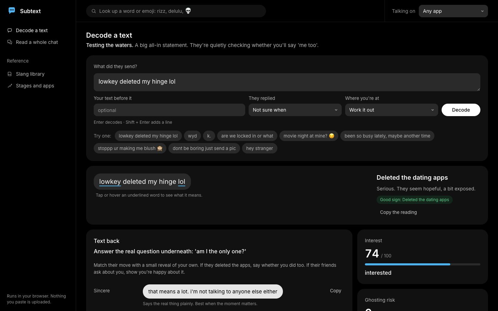
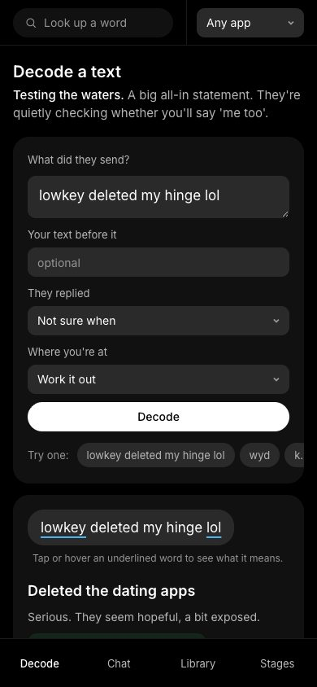
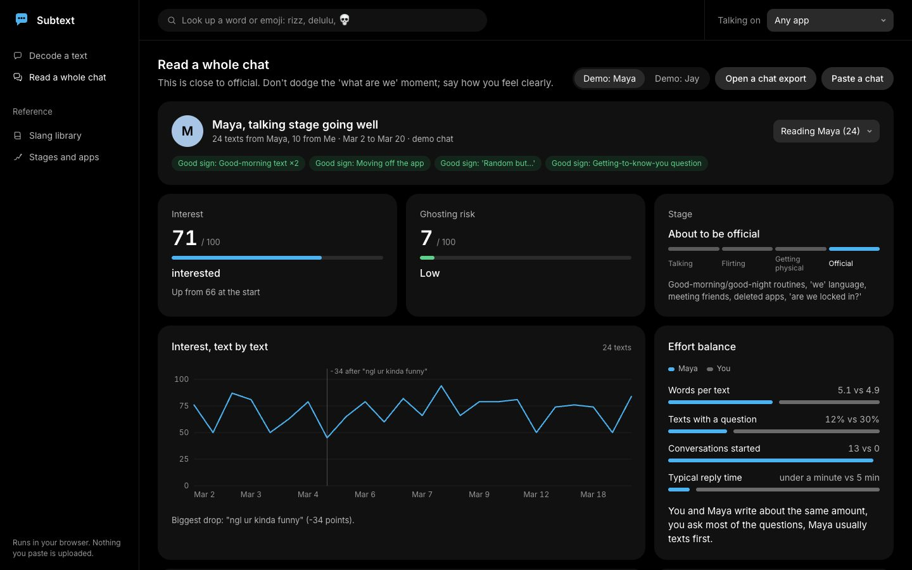

<h1 align="center">Subtext (subtext analysis simulator)</h1>

<p align="center"><b>Read what their text really means, and what to text back.</b></p>

<p align="center">
  
  
  
  
  
  <br>
  
  
  
  
</p>

<!-- The buttons open the app from this folder. Once it's published (for example with GitHub Pages),
     point them at the live address, e.g. https://<username>.github.io/genz-text-decoder/web/ -->
<p align="center">
  <a href="web/index.html#decode"></a>
  &nbsp;
  <a href="web/index.html#chat"></a>
</p>
<p align="center">
  <i>Opens in your browser. No install, no account, nothing you paste leaves your device.</i>
</p>

<p align="center">
  
  &nbsp;
  
</p>

Paste what your crush, talking stage or situationship sent. Subtext reads the words, the emoji and
how it was typed, then tells you:

- the **tone** and how they probably **feel**;
- what it **implies** ("lowkey deleted my hinge lol" is them checking whether you'll say "me too");
- how **interested** they seem, from 0 to 100;
- which **stage** you're in: talking, flirting, getting physical, about to be official, situationship or fading;
- the **ghosting risk**, with the reasons;
- three ways to **text back** (match their energy, playful, sincere) and what to **avoid**.

Give it a whole chat and it also tracks interest text by text, who puts in more effort, who texts
first, how fast each of you replies, and your next move.

<p align="center">
  
</p>

It runs entirely in your browser. Nothing you paste is uploaded.

## Use it

Open `web/index.html` in a browser. That's it: no install, no server, no build step.

Or serve the folder if you prefer:

```bash
python3 -m http.server 8790 --directory web
```

Then open http://127.0.0.1:8790. The four screens:

| Screen | What it's for |
|---|---|
| **Decode a text** | One text, with each slang word and emoji underlined and decoded where it sits |
| **Read a whole chat** | Open a WhatsApp, iMessage/SMS CSV or Telegram JSON export, paste a chat, or try the two demo chats |
| **Slang library** | Every word, emoji and phrase Subtext knows, searchable by spelling or meaning |
| **Stages and apps** | What each stage looks like, what to do, the ghosting signs, and what each app's habits mean |

Pick the app you're talking on in the top bar (Snapchat, Instagram, TikTok, iMessage, WhatsApp,
dating apps, Discord) and every reading adds that app's norms.

## Command line

Python 3.10+, standard library only.

```bash
python3 cli.py "lowkey deleted my hinge lol"
python3 cli.py "k." --after "omg how was the concert?? tell me everything" --delay 600
python3 cli.py "u up?" --platform snapchat
python3 cli.py --file examples/jay.txt --them Jay
python3 cli.py --eval
```

## What it knows

Everything lives in `subtext/data/`:

- **343 slang terms**, each tagged by where it comes from: mainstream Gen Z, Gen Alpha, AAVE, Black
  and Latinx LGBTQ+ ballroom culture, Twitter/Discord, TikTok algospeak, UK, Australian, Spanish and
  Spanglish, Arabic, K-pop, gaming and millennial;
- **94 emoji** by their Gen Z meaning (😭 is laughing, 🙂 is passive-aggressive, 👍 reads cold);
- **63 subtext patterns**, from "my friends keep asking about you" to "we'll see" to "don't be boring";
- a **reply playbook** for 23 kinds of text, 6 stages and 7 apps.

The data is curated by hand from how these words are used in public. No real person's messages were
collected. The example texts are written for the project.

## How good is it

`python3 cli.py --eval` checks which kind of text each example is read as:

- `labelled.jsonl`: 135/135. Used while writing the patterns, so this only shows nothing broke.
- `holdout.jsonl`: 31/32. Written afterwards and not tuned against.

Real chats are messier, especially with sarcasm and inside jokes. It's a rule-based reading that
shows its reasons, not mind reading; when it matters, ask the person.

## Safety

- Pressure, guilt-tripping and controlling texts are flagged red; the advice is to hold your boundary.
- Advice for getting physical is about pace and consent, and about not sending intimate pictures.
- Texts that may mean self-harm (including algospeak like "unalive") get a check-in and a crisis line
  (988 in the US), not dating strategy.

## Project layout

```
subtext/decoder.py      the engine: one text, or a whole chat
subtext/chat_parser.py  chat exports → messages
subtext/data/           slang, emoji, signals, playbook, labelled examples
cli.py                  command line
web/index.html          the app (open it directly)
web/app.js, app.css     the four screens
web/engine.js           the same engine in JavaScript
web/parse.js            the same chat parser in JavaScript
web/charts.js           small SVG charts
web/data.js             generated by tools/build_web.py; don't edit by hand
docs/                   screenshots used in this README
examples/               two demo chats (fictional)
tests/                  python3 -m unittest discover tests
```

After changing anything in `subtext/data/` or `examples/`, run `python3 tools/build_web.py`. The
tests include a check that the Python and JavaScript engines give the same reading for every example
and demo chat (it needs Node).

## Credits

The engine and data started in [TextBack Analysis Engine](https://github.com/yesjermo/textback-analysis-engine).
The interface follows the "true-black flat" app style from the tasteskill design skill. MIT licence.
